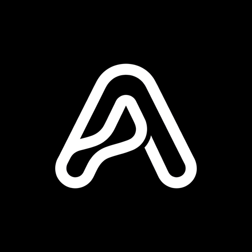
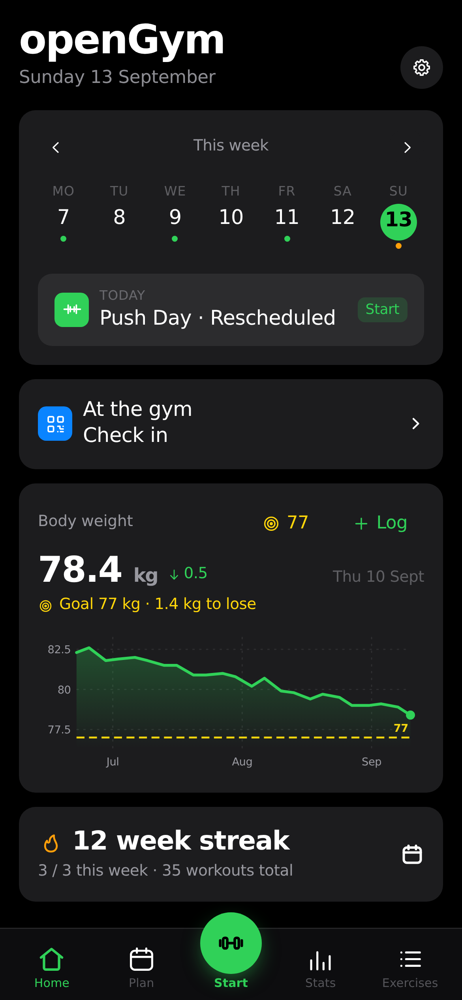
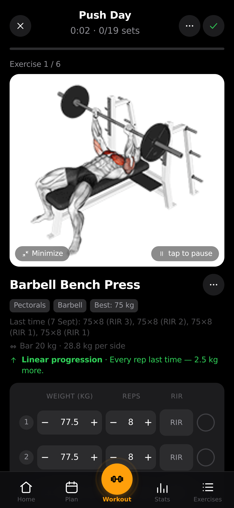
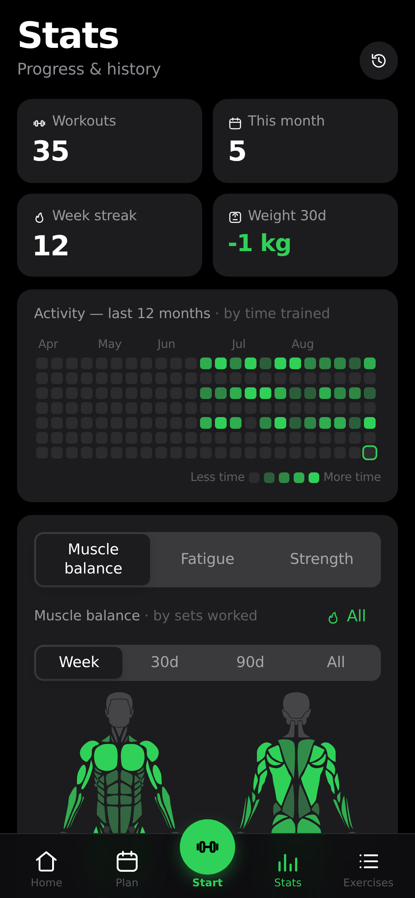

<div align="center">



# APEX Fitness

**A high-performance, self-hosted fitness platform and progressive overload tracker you truly own.**

Plan routines, execute guided workouts, log every set and body weight metric on web and mobile,<br>
synced across your devices, secured behind your own biometric Passkey sign-in.

[](LICENSE)
[](docs/APEX_GUIDE.md)
[](docker-compose.yml)

[Quick Start](#quick-start) ·
[Features](#features) ·
[Mobile Applications](#mobile-applications) ·
[Architecture](#architecture) ·
[APEX Guide](docs/APEX_GUIDE.md) ·
[Upstream & License](#licensing--attribution)

</div>

<table align="center">
<tr>
<td align="center"><br><sub><b>Home</b> · today's workout and weight</sub></td>
<td align="center"><br><sub><b>Guided workout</b> · demos and sets</sub></td>
<td align="center"><br><sub><b>Stats</b> · heatmap, charts and PRs</sub></td>
</tr>
</table>

---

## Why APEX Fitness

Commercial fitness apps lock your personal data into proprietary silos, push aggressive subscriptions, and disappear when their servers go down. 

**APEX** operates on your own infrastructure, preserves your fitness logs in a directory you own, and functions seamlessly everywhere:
* **No subscriptions, no ads, no telemetry**.
* **Modern biometric authentication**: Passkeys (Touch ID, Face ID, fingerprint) with zero password vulnerability.
* **Offline-first with multi-device sync**: Train with no signal; edits sync automatically when back online.
* **Full platform coverage**: Progressive Web App (PWA), installable Android APK, and native iOS project.

---

## Features

### 🏋️ Planning & Training
* **Over 5,600 Exercises**: Comprehensive animated demonstrations, browsable by muscle group on an interactive body map.
* **Built-in Routine Starter Plans**:
  * **APEX 6-Day V-Taper / Aesthetic Hypertrophy** (Chest/Shoulders, Back/Abs, Legs/Calves, Shoulders/Arms focus).
  * Push / Pull / Legs (PPL).
  * Upper / Lower split.
  * Full Body & 5×5 strength programs.
* **Smart Progressions**: Linear, Greyskull LP, Double Progression through visible rep ranges, and Triple Progression.
* **Rest Timers & Plate Math**: Automated interval countdown with screen flash alert, bar math for standard, EZ bar, and Smith machines.
* **Effort Tracking**: Color-coded RIR (Reps in Reserve) and RPE metrics.

### 📊 Progress & Analytics
* **1RM Progression Curve**: Estimated one-rep maximum per movement over time.
* **Structural Balance Ratios**: Poliquin, Thibaudeau, and ATG strength balance calculations.
* **Muscle Recovery Heatmap**: Real-time volume, recovery status, and fatigue visualizer across major muscle groups.
* **Body Composition Tracking**: Weight target timelines and before/after photo slider.

### 🔒 Accounts, Security & Privacy
* **Biometric Passkeys (WebAuthn)**: Single-tap sign-in with Face ID, Touch ID, or security keys.
* **Deterministic CRDT Synchronization**: Multi-device offline editing merges without data loss.
* **Zero Cloud Lock-in**: Single-click JSON export/import and compatibility with Strong, Hevy, FitNotes, and Apple Health.
* **Optional Admin Dashboard**: User management, invite-only onboarding, and audit logging.

---

## Quick Start

### Running with Docker Compose

Ensure Docker and Docker Compose are installed, then run:

```bash
# 1. Copy environment template
cp .env.example .env

# 2. Launch APEX web and API containers
docker compose up -d

# 3. Open your browser
open http://localhost:8080
```

To stop:
```bash
docker compose down
```

---

## Mobile Applications

APEX is built with modern web and native mobile tooling using Capacitor:

### 📱 Android Application
* **Package**: `com.apex.fitness`
* **App Name**: `APEX`
* **Building Debug APK**:
  ```bash
  cd frontend/android
  ./gradlew assembleDebug
  ```
* **Building Release APK**:
  ```bash
  cd frontend/android
  ./gradlew assembleRelease
  ```

### 🍎 iOS / iPadOS Application
* **Bundle ID**: `com.apex.fitness`
* **Display Name**: `APEX`
* Open the native Xcode workspace:
  ```bash
  open frontend/ios/App/App.xcworkspace
  ```
* Select your device/simulator and press **Cmd + R** to run.

For full build toolchain details, refer to the [**APEX Guide**](docs/APEX_GUIDE.md).

---

## Technical Stack

* **Frontend**: React 19, Vite, Zustand, Tailwind CSS, Lucide Icons
* **Backend API**: Node.js 22 HTTP service, SimpleWebAuthn
* **Mobile Runtime**: Capacitor 7, Android SDK 35, iOS CocoaPods
* **Containerization**: Nginx Alpine reverse proxy, multi-stage Docker build

---

## Licensing & Attribution

* **Software License**: APEX Fitness is free software licensed under the **GNU Affero General Public License v3.0** ([AGPL-3.0](LICENSE)).
* **Upstream Project**: APEX is an independent fork and customized distribution of [openGym](https://github.com/DuarteSantos8/openGym) created by **Duarte Santos**. We express immense gratitude to the openGym author and contributors for the foundational codebase.
* **Exercise Media**: Exercise animations and illustrations in `catalogue/media/` are copyright © Aliaksandr Makatserchyk, Gym visual ([gymvisual.com](https://gymvisual.com)) and are subject to their proprietary license terms.
* **Diagrams & Components**: Anatomical geometry derived from [MuscleMap](https://github.com/melihcolpan/MuscleMap) by Melih Colpan (MIT License).

See [**NOTICE.md**](NOTICE.md) for full legal disclosures, third-party licenses, and copyright statements.
